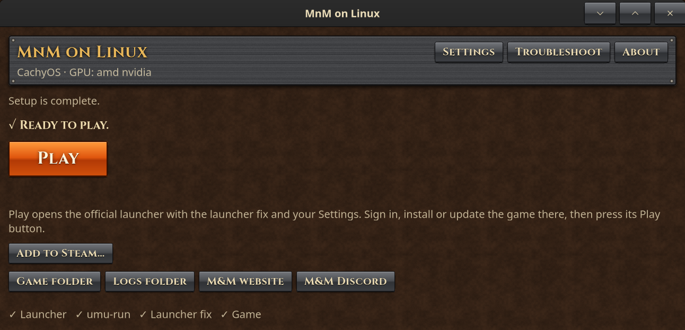
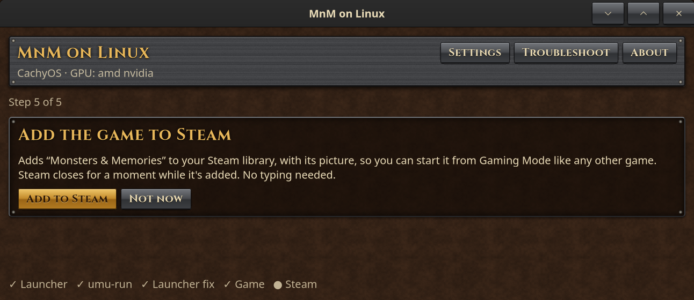

# MnM on Linux

Set up, play and troubleshoot Monsters & Memories on Linux with the official Linux launcher (AppImage). It gets the launcher and `umu-run` for you, applies the fix the launcher needs on Linux, starts the game with your graphics settings, and when something goes wrong it checks everything the launcher needs and tells you exactly what to do about it, with commands for your distro and GPU.

Unofficial community tool, not made, affiliated with or endorsed by the Monsters & Memories team.



## Use it

1. Download **`mnm-on-linux.py`** from the [latest release](../../releases/latest).
2. Double-click it, or run it in a terminal:

   ```sh
   python3 mnm-on-linux.py
   ```

3. Follow the steps. The window shows one step at a time with one button; when they're all done it shows **Play**.

Nothing is downloaded, installed or changed until you press a button and confirm. Commands that need your password are never run for you: the window shows them with a **Copy** button.

### Steps

In order, skipping any that are already done (a line at the bottom shows ✓ done, ● current, ○ still to do):

1. **Get the official launcher**: downloads it into `~/Games/MonstersAndMemories`, or choose a file you already have.
2. **FUSE 2**, only if it's missing: a copyable command to run in a terminal (it needs your password).
   **Allow Proton's sandbox**, only on the rare systems that turn off user namespaces: also a copyable command.
3. **Install umu-run**: its single-file version into `~/.local/bin`, no password.
4. **Apply the launcher fix** (or **Update fix** if you have an older one).
5. **Install the game**: opens the launcher; sign in and press Install there.
6. **Add the game to Steam**, on a Steam Deck (and other systems with a Gaming Mode): see [Steam Deck](#steam-deck). On other computers with Steam, an optional **Add to Steam…** button sits under Play instead.

If the game's Wine folder is damaged (empty system files after a crash during the first start), a **Repair** step comes first. Then the window shows **Play**, which opens the official launcher with the launcher fix and your Settings, and shows whether the launcher or game is running.

The buttons at the top open the other pages; **← Back** returns to the steps:

| Page | What it does |
| --- | --- |
| Settings | Graphics card on computers with two GPUs, DXVK or WineD3D, native Wayland, HDR, MangoHud, GameMode and launch options. Saved to `~/.config/mnm-on-linux/settings.conf` and used the next time the game starts. |
| Troubleshoot | The full launcher check, with the buttons below. |
| About | Version, update check (updates replace the file after you confirm), links. |

### Troubleshoot buttons

| Button | What it does |
| --- | --- |
| Check again | Re-runs every check. Read-only. |
| Test Proton | Runs a harmless Windows command through `umu-run` in the game's prefix, without starting the game. The first run may download GE-Proton (about 500 MB). |
| Watch for Play | Waits up to 10 minutes for you to press Play, then confirms the game really started, shows which GPU it renders on, and, if it hangs, shows what Proton printed. |
| Apply launcher fix… | Installs a small `umu-run` wrapper and launch script that stop the AppImage's environment from crashing `umu-run` (the "nothing happens" bug), and apply your Settings. Writes only to your home folder. |
| Copy report | Copies the whole result as text, to paste into a [bug report](../../issues/new/choose) or Discord. Personal data is left out (see below). |
| Choose AppImage… | Use this if your launcher AppImage isn't in `~/Games`, `~/Applications`, `~/Downloads` or a similar folder. |

**Launch options** work like Steam's: `VARIABLE=value` settings, then `%command%`, then arguments for the game, for example `%command% -popupwindow` (borderless window), `DXVK_HUD=fps %command%` or `PROTON_LOG=1 %command%`. Don't add `--token`: the launcher already passes its own, and the window warns about it. A command before `%command%` (such as `taskset -c 0-3`) runs the game through it. Below the box, the window shows what the options will do. They need the launcher fix from v2.1.0 on; with an older one, the window offers **Update fix**.

Upgrading from the old **Linux Check** (v1)? Press **Update fix** when the window shows it so the wrapper uses your Settings. The old fix keeps working until then.

## Steam Deck

Everything is done with taps, in Desktop Mode (press the **STEAM** button → **Power** → **Switch to Desktop**):



1. Open the browser, go to the [latest release](../../releases/latest) and download **`mnm-on-linux.py`**.
2. In the Downloads folder, tap and hold the file → **Properties** → **Permissions** → tick **Is executable** → OK. Then open it.
3. Go through the steps. Sign in and install the game in the launcher while you're still in Desktop Mode (the keyboard is easier there).
4. **Add to Steam** adds "Monsters & Memories" to your Steam library with its picture. Steam closes for a moment while it's added (a copy of the old shortcut list is kept as `shortcuts.vdf.mnm-backup`), then the window offers **Return to Gaming Mode**.
5. In Gaming Mode it's first on the Home screen (and under **Library → Non-Steam**). Start it and press Play in the launcher. If the launcher asks you to sign in again, **STEAM + X** opens the keyboard.

Steam starts the launcher through `~/.local/share/mnm/mnm-steam.sh`, which gives it the system's libraries instead of Steam's, then runs the same launch script as the app-menu entry, so your Settings apply in Gaming Mode too. The library pictures are made from the launcher's own icon, and pictures you've set yourself in Steam are never replaced.

## What it checks

1. 64-bit x86 CPU
2. The launcher AppImage: found, executable, FUSE 2 installed
3. Game files (`mnm.exe` and core files) next to the AppImage
4. `umu-run`: on the launcher's `PATH`, actually runs, wrapper in place
5. GE-Proton, the Steam Linux Runtime, the Vulkan loader, a Vulkan driver for your GPU (and AMDVLK conflicts), and laptops with two GPUs
6. The game's Wine prefix
7. Errors in the launcher's last log
8. Python and PyGObject/GTK

## What it runs

This section lists every command the tool runs and every file it writes. The window keeps the checks in a temporary copy of `mnm-linux-check.sh`, runs it with `bash`, and deletes the copy when the run finishes.

### The check (read-only)

**Check again**, the terminal check and the start of every other button run these. None of them changes anything.

| Command or file read | Why |
| --- | --- |
| `uname -m` | Is the CPU 64-bit x86? |
| `/etc/os-release`, `/etc/mx-version` | Your distro, so the fix commands are the right ones for it |
| `/sys/class/drm/card*/device/vendor`, `/sys/class/power_supply/BAT*` | Which GPUs you have, and whether it's a laptop |
| `pgrep -x mnm_launcher`, then the launcher's `/proc/<pid>/environ` | Is the launcher open, and which AppImage and `PATH` is it using? |
| `find ~/Games/MonstersAndMemories ~/Applications ~/Downloads ~/Desktop ~/Games ~/.local/bin ~ /opt -maxdepth 1 -iname 'MonstersAndMemories*.appimage'` | Finds the launcher (the newest one wins) |
| `ldconfig -p` (also tries `/sbin/ldconfig`) | Is FUSE 2 (`libfuse.so.2`) installed? Is the Vulkan loader (`libvulkan.so.1`)? |
| `head -c2 mnm.exe` | Is `mnm.exe` a real Windows program? (It starts with `MZ`.) |
| `grep` in `~/.local/share/applications/*.desktop` | Finds the launcher's app-menu entry |
| `systemctl --user show-environment` | The `PATH` your desktop gives the launcher, which can differ from your terminal's |
| `umu-run --version` (stops after 30 s) | Does `umu-run` actually run? |
| `curl https://api.github.com/repos/Open-Wine-Components/umu-launcher/releases/latest` | Only when `umu-run` is missing or broken: gets the newest version number for the install command it shows |
| `grep` in `~/.xsession-errors` and `~/.local/share/mnm/launcher.log` | Known crash messages (`No module named 'encodings'`, white window, Pango) |
| `grep -qa hb_ot_layout_get_horizontal_baseline_tag_for_script libharfbuzz.so.0` | Is your HarfBuzz too old for the launcher's Pango? (Ubuntu 22.04 and distros based on it.) |
| `/proc/sys/kernel/unprivileged_userns_clone`, `/proc/sys/user/max_user_namespaces` | Can Proton's sandbox start? |
| `ls` of `compatibilitytools.d/GE-Proton*` and `~/.local/share/umu/steamrt*` | Are GE-Proton and the Steam Linux Runtime downloaded? |
| `ls /usr/share/vulkan/icd.d /etc/vulkan/icd.d` | Is there a Vulkan driver for each GPU? Is AMDVLK installed? |
| `vulkaninfo --summary` (if installed, stops after 20 s) | Which GPUs Vulkan can see |
| `prime-select query` (if installed) and `/proc/driver/nvidia/version` | On NVIDIA laptops: is the NVIDIA driver loaded and switched on? |
| `find` for empty `.dll`/`.exe` files in the prefix's `system32` and `syswow64` | Is the game's Wine folder damaged? |
| `python3`, then `import gi` with GTK 4 or 3 | Can the window open? |

### Buttons that change something

Each one asks you to confirm first.

| Button | What it runs | What changes |
| --- | --- | --- |
| Download (Get the official launcher) | Downloads `MonstersAndMemories_amd64.AppImage` from the official download link (saved as a `.part` file until it's complete), then makes it executable | New file in `~/Games/MonstersAndMemories` |
| Choose AppImage… | Nothing | Saves the path as `MNM_APPIMAGE` in `settings.conf` |
| Make runnable | Same as `chmod +x` on the AppImage | The AppImage's permissions |
| Install umu-run | Asks GitHub for the newest umu-launcher release (1.4.4 if that fails), downloads `umu-launcher-<version>-zipapp.tar` and unpacks only `umu/umu-run` | New file `~/.local/bin/umu-run` |
| Apply launcher fix / Update fix | `bash mnm-linux-check.sh --fix` | See [What the launcher fix installs](#what-the-launcher-fix-installs) |
| Repair | Renames the game's Wine folder | `~/.local/share/mnm/mnm/pfx` becomes `pfx.broken-<date>-<time>`, and a fresh one is made on the next Play |
| Test Proton | `--test`: runs `umu-run <prefix>/drive_c/windows/system32/cmd.exe /c "echo MNM_LINK_OK> C:\mnm-link-test.txt"` with the launcher's settings (`WINEPREFIX`, `GAMEID=umu-monstersandmemories`, `PROTONPATH=GE-Proton`, `PROTON_VERB=run`). It stops after 15 minutes. In a new prefix it first runs `umu-run ""` to create the prefix. It's skipped while the game is running | The test file, which it deletes afterwards. The first run may download GE-Proton and the Steam Linux Runtime |
| Watch for Play | `--watch`: every 2 s, `pgrep -u <you> -f 'mnm\.exe'`. Then it reads the game's program name and environment (`GAMEID`, prefix, `PROTONPATH`, GPU offload settings), the GPU devices it has open (`/proc/<pid>/fd`) and the `Renderer:` line in `Player.log`. It never reads the game's arguments, which hold your login token | Nothing |
| Play | `~/.local/share/mnm/mnm-launcher.sh` | Nothing |
| Settings → Save | Nothing | Writes `~/.config/mnm-on-linux/settings.conf` |
| Add to Steam | Writes `~/.local/share/mnm/mnm-steam.sh`. Runs `<AppImage> --appimage-extract '*.png'` in a temporary folder and keeps the largest icon as `~/.local/share/mnm/icon.png`, then makes three library pictures from it. Runs `steam -shutdown` and waits up to 60 s. Afterwards runs `steam` to restart it, or **Return to Gaming Mode** runs `steamos-session-select gamescope` (or `steamosctl switch-to-game-mode`) | For each Steam account in `userdata/<id>/config` (under `~/.steam/steam`, `~/.local/share/Steam` or the Flatpak's Steam folder): `shortcuts.vdf` is copied to `shortcuts.vdf.mnm-backup` and gets a "Monsters & Memories" entry (skipped if it already has one). `grid/<appid>p.png`, `<appid>.png` and `<appid>_hero.png` are written unless they already exist |
| About → Update | Downloads `mnm-on-linux.py` from the latest release to `mnm-on-linux.py.new`, checks that it's a complete Python file, then restarts into it | Replaces the file you started |
| Links | Your default browser (`xdg-open`) | Nothing |

On first start the window writes its font (Cinzel) and leather and iron textures to `~/.cache/mnm-on-linux/theme-1`. Nothing is installed. If GTK is missing and there's no terminal, it explains why with `kdialog`, `zenity` or `notify-send`, whichever it finds first.

### What the launcher fix installs

`--fix` writes two scripts and points the app-menu entry at the second one. Everything stays in your home folder.

**1. `~/.local/share/mnm/bin/umu-run`** ("mnm-wrapper 3"). The launcher runs this in place of the real `umu-run` every time you press Play. It:

- runs `unset PYTHONHOME PYTHONPATH LD_LIBRARY_PATH LD_PRELOAD GTK_DATA_PREFIX GTK_THEME GTK_EXE_PREFIX GTK_PATH GTK_IM_MODULE_FILE GDK_PIXBUF_MODULE_FILE GDK_BACKEND GIO_EXTRA_MODULES GSETTINGS_SCHEMA_DIR`. These are the AppImage's own settings, and they crash `umu-run`.
- removes the AppImage's folders from `PATH` and `XDG_DATA_DIRS`, and unsets `APPDIR APPIMAGE ARGV0 OWD`
- reads `settings.conf` and sets:

  | Setting | Variable |
  | --- | --- |
  | Graphics card (two GPUs; "auto" only on laptops) | NVIDIA: `__NV_PRIME_RENDER_OFFLOAD=1 __VK_LAYER_NV_optimus=NVIDIA_only __GLX_VENDOR_LIBRARY_NAME=nvidia`; AMD/Intel: `DRI_PRIME=1` |
  | WineD3D | `PROTON_USE_WINED3D=1` |
  | Native Wayland | `PROTON_ENABLE_WAYLAND=1` |
  | HDR | `PROTON_ENABLE_WAYLAND=1 PROTON_ENABLE_HDR=1` |
  | MangoHud (if installed) | `MANGOHUD=1` |
  | GameMode (if installed) | runs the game through `gamemoderun` |
  | Launch options | `VAR=value` exported last, so they win. A command before `%command%` goes in front (skipped if it isn't installed). Arguments go after the launcher's own. The options are logged with `--token` hidden |

- then runs `exec [launch-option command] [gamemoderun] <real umu-run> <launcher's arguments> [your arguments]`

**2. `~/.local/share/mnm/mnm-launcher.sh`** ("mnm-launch 4"). The app-menu entry, Play and Steam all start this. It:

- finds the newest `MonstersAndMemories*.AppImage` in the folder you set up with, falling back to the usual folders. If there's none, it writes that to the log, shows a `notify-send` message and stops
- sets `PATH=~/.local/share/mnm/bin:$PATH:~/.local/bin`, so the launcher finds the wrapper first
- `LD_PRELOAD`s the system's `libwayland-client.so.0`, because the AppImage's own copy gives a white window on new Mesa. `MNM_NO_WAYLAND_PRELOAD=1` skips this
- with an old HarfBuzz only: `LD_PRELOAD`s the system's `libpangocairo`, `libpangoft2` and `libpango`. `MNM_NO_PANGO_PRELOAD=1` skips this
- moves `launcher.log` to `launcher.log.old` once it's over 5 MB, then runs the launcher with its output added to `~/.local/share/mnm/launcher.log`

**3. The app-menu entry.** If the launcher already has one in `~/.local/share/applications`, its `Exec=` line is changed to the launch script, and the original is copied once to `~/.local/share/mnm/desktop-entry.backup`. If it has none, `mnm-launcher.desktop` is created. Then `update-desktop-database ~/.local/share/applications` runs, if you have it.

To undo the fix, delete `~/.local/share/mnm/bin/umu-run` and `~/.local/share/mnm/mnm-launcher.sh`, then copy `desktop-entry.backup` back over the menu entry, or delete `mnm-launcher.desktop`.

**Steam's script, `~/.local/share/mnm/mnm-steam.sh`** ("mnm-steam 1"), is written only by Add to Steam. It puts back the system's `PATH` and `LD_LIBRARY_PATH` (Steam passes its own), unsets `LD_PRELOAD`, and runs the launch script.

### Commands it only shows

The tool never runs these. They need your password or change your system, so the window shows each one with a **Copy** button, and the terminal check prints them.

| When | Command (Arch / Fedora / Debian and Ubuntu / openSUSE) |
| --- | --- |
| FUSE 2 missing | `sudo pacman -S --needed fuse2` / `sudo dnf install fuse-libs` / `sudo apt install libfuse2t64` (`libfuse2` on Debian 12, Ubuntu 22.04 and older) / `sudo zypper install libfuse2` |
| User namespaces off | `echo kernel.unprivileged_userns_clone=1 \| sudo tee /etc/sysctl.d/90-mnm-userns.conf && sudo sysctl -w kernel.unprivileged_userns_clone=1` (or the same with `user.max_user_namespaces=15000`) |
| umu-run missing (terminal check) | `sudo pacman -S --needed umu-launcher` / `sudo dnf install umu-launcher` / on Debian 12–13 and Ubuntu 24.04, `wget` of the two umu-launcher `.deb` files from GitHub, then `sudo apt install ./…deb ./…deb`. Elsewhere, and on SteamOS and Bazzite: the zipapp into `~/.local/bin`, without `sudo` |
| umu-run not on the desktop's `PATH` | `mkdir -p ~/.config/environment.d && echo 'PATH=<its folder>:${PATH}' >> ~/.config/environment.d/mnm.conf`, then log out and back in |
| AppImage not executable (terminal check) | `chmod +x <AppImage>` |
| Vulkan loader missing | `vulkan-icd-loader lib32-vulkan-icd-loader` / `vulkan-loader` / `libvulkan1` / `libvulkan1` |
| No Vulkan driver | NVIDIA: `sudo pacman -S --needed nvidia-utils lib32-nvidia-utils` / `sudo dnf install akmod-nvidia xorg-x11-drv-nvidia-libs.i686` (RPM Fusion) / `sudo ubuntu-drivers install`. AMD: `vulkan-radeon lib32-vulkan-radeon` / `mesa-vulkan-drivers mesa-vulkan-drivers.i686` / `mesa-vulkan-drivers` / `libvulkan_radeon`. Intel: the same with `intel` |
| AMDVLK installed | `sudo pacman -R amdvlk lib32-amdvlk` / `sudo dnf remove amdvlk` / `sudo apt remove amdvlk` / `sudo zypper remove amdvlk` |
| NVIDIA GPU switched off | `sudo prime-select on-demand`, then reboot |
| Damaged prefix (terminal check) | `mv ~/.local/share/mnm/mnm/pfx ~/.local/share/mnm/mnm/pfx.broken-<date>` |
| Python, PyGObject or GTK missing | See [Requirements](#requirements) |
| MangoHud or GameMode missing (Settings) | Your distro's install command. On Bazzite and other image-based systems it's `rpm-ostree install …`, then restart |

## Requirements

Python 3 (`umu-run` needs it too) plus PyGObject with GTK 4 or 3 for the window. GNOME, Ubuntu, Linux Mint, Fedora, Bazzite and SteamOS usually have these already. If they're missing, the check shows the command for your distro, and the window falls back to the terminal check (no steps, Settings or Play there).

- Terminal only: `python3 mnm-on-linux.py --cli` (supports `--test`, `--watch`, `--fix`, `--appimage PATH`), or run `mnm-linux-check.sh` with bash.
- For a bug report from the terminal: `python3 mnm-on-linux.py --cli --watch --report` prints the result without personal data.

| Distro | Install command |
| --- | --- |
| Arch, CachyOS, Manjaro, EndeavourOS | `sudo pacman -S --needed python python-gobject gtk4` |
| Ubuntu, Linux Mint, Debian, Pop!_OS | `sudo apt install python3 python3-gi gir1.2-gtk-4.0` |
| Fedora, Nobara | `sudo dnf install python3 python3-gobject gtk4` |
| openSUSE | `sudo zypper install python3 python3-gobject-Gdk typelib-1_0-Gtk-4_0` |

### Laptops with two GPUs

On laptops with an integrated plus a discrete GPU, the game can start on the slow integrated GPU, or sit on "Game is running" with no window (NVIDIA Optimus). The check detects this, and with the launcher fix the game uses the discrete GPU: PRIME render offload on NVIDIA, `DRI_PRIME=1` on AMD/Intel + AMD. Change this under **Settings → Graphics card** ("Always use the fast card" for desktops, "Let the system decide" to turn it off). `MNM_NO_PRIME_OFFLOAD=1` still turns it off too.

### Ubuntu 22.04 and distros based on it

On Pop!_OS 22.04, Linux Mint 21, Zorin OS 17, elementary OS 7 and other Ubuntu 22.04-based systems, the official launcher quits as soon as you open it (`undefined symbol: hb_ot_layout_get_horizontal_baseline_tag_for_script`). It brings its own copy of a text library (Pango) that needs a newer HarfBuzz than these systems have. The launcher fix handles this: there, it starts the launcher with your system's own Pango, so open the launcher from the app menu entry, not from the AppImage file. `MNM_NO_PANGO_PRELOAD=1` turns this off.

### Privacy

The check never shows personal data. Paths in your home folder appear as `~/…`, download IDs in file names as `<id>`, and anything it copies out of logs or tools (Proton/Wine output, error messages) has these removed:

- your user name and computer name
- home folders (`/home/…`, `/var/home/…`, Wine's `Z:\home\…` and `C:\users\…`), and your name in `/run/media/…`
- the launcher's login token, and any `token=`, `password=`, `secret=` or `auth=` values or web tokens
- e-mail addresses, IP and MAC addresses, and machine or download IDs

**Copy report** and `--report` run the whole report through the same filter again before you share it. A report keeps what's useful for fixing problems: your distro, GPU models, and driver, Proton and umu versions.

## Look

The window is styled after the game's own windows: dark leather, iron and gold. Headings use the Cinzel font (SIL Open Font License 1.1, see `gui/fonts/OFL.txt`), which is built into the file and only loaded for this window; nothing is installed. The leather and iron textures are made on first start and kept in `~/.cache/mnm-on-linux`.

## Building

`mnm-linux-check.sh` holds the checks and `gui/mnm_check_gui.py` holds the window. Run `./build.sh` to combine them (and the Cinzel font) into the single file `dist/mnm-on-linux.py`.
